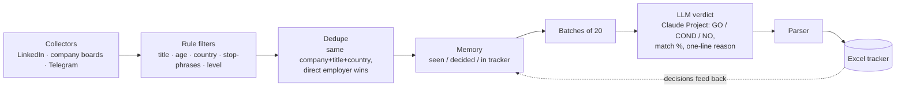

# Lodestar

A personal job-search pipeline: **rules do the sorting, an LLM does only the judging.** A hybrid AI-assisted pipeline, not an autonomous agent.

> **Design principle**
> Use deterministic logic for decisions with explicit rules, and reserve LLM calls for contextual judgments that cannot be reliably expressed as simple filters. Keep decisions auditable, preserve state across runs, and feed human reviews back into the system.

I'm a Senior Product Manager looking for roles across Europe. Vacancies are scattered over LinkedIn, company career pages and Telegram channels, reposted by agencies and published in several countries. Lodestar collects them, throws away what a rule can reject, remembers what I have already seen, and prepares the remaining vacancies in batches for LLM evaluation. I paste each batch into a Claude Project, which returns a verdict with a reason, and the program reads the answers back.

## Architecture



## What code decides vs. what the LLM decides

| Code (rule-based, deterministic, repeatable) | LLM (judgment) |
|---|---|
| Collecting from several sources | Does this role fit my experience? |
| Title must be a product role | Which requirements are real blockers vs. wish-list? |
| Drop vacancies older than 30 days | One-line reason for every verdict |
| Country and "hires from Europe" checks | |
| Hard stops: required language, level | |
| Deduplication across sources and countries | |
| Remembering what was seen or decided | |
| Batching, parsing verdicts, updating the tracker | |

Rule of thumb: if a decision can be written as a rule, it is code. The LLM only sees what survives.

## Numbers

Three independent measurements, taken from the pipeline's own logs. They cover different periods and are **not** one funnel.

**1. Funnel of one run (6 Nov 2026, 18:13), reproducible from the run's step files**

| Stage | Left | Removed |
|---|---|---|
| Collected | 1,429 | |
| Title looks like a product role | 742 | 687 |
| Title rules | 496 | 246 |
| Hard stop-phrases | 242 | 254 |
| Deduplication | 223 | 19 |
| Already in tracker | 222 | 1 |
| Already seen in earlier runs (memory) | **31 prepared for LLM evaluation** | 191 |

Rules and deduplication removed 1,206 (84%), memory removed 192 (13%), and the remaining 31 (2%) were new and prepared for LLM evaluation.

**2. Repeats, eight collections (4–7 Nov 2026)**
- 7,661 listings (each vacancy counted once per collection) → 4,086 unique vacancies
- 1,884 of the 4,086 unique vacancies (46%) appeared in two or more collections; in total, 3,575 listings were repeat sightings (7,661 − 4,086)

**3. LLM verdicts, cumulative over all runs to date**
- 601 vacancies scored: 17 GO, 51 COND, 533 NO (11.3% GO+COND)
- This is a cumulative result across all runs, not a continuation of either measurement above.

Time saved has not been measured yet. I plan to compare end-to-end processing time against a manual review baseline.

## Lessons

- **Rules need audit.** Two broad title rules (`platform`, `lead`) were removing roles close to my experience. I found this by reading what the rules rejected, removed both rules and re-scored the affected vacancies. *(Result of the re-scoring: not measured yet.)*
- **Collection must be incremental.** A long LinkedIn run that hits rate limits (HTTP 429) used to lose everything. Vacancies are now written to a checkpoint file as they are collected, and Ctrl+C processes what is already there.
- **Persistent memory prevents repeated work.** Almost half of the vacancies in a four-day window were repeats. Without memory, I would re-read them.

## Screenshots

*[Add: funnel report · one batch of verdicts · tracker view. Blur company names if needed.]*

## Run

```
py -3.12 -m src.run --profile <profile.yaml> --private <private-folder>
py -3.12 -m src.run ... --from-raw <00_raw.jsonl>   # re-run filters without scraping
py -3.12 -m src.run ... --verdicts answers.txt      # apply LLM verdicts
```

## Not in this repository

The LinkedIn collector and my personal profile (CV facts, filters) are kept in a private repository.

## Stack

Python · SQLite · Excel tracker · Claude Project for scoring. Built with Claude as an AI coding assistant; the architecture, rules and screening criteria are mine.
